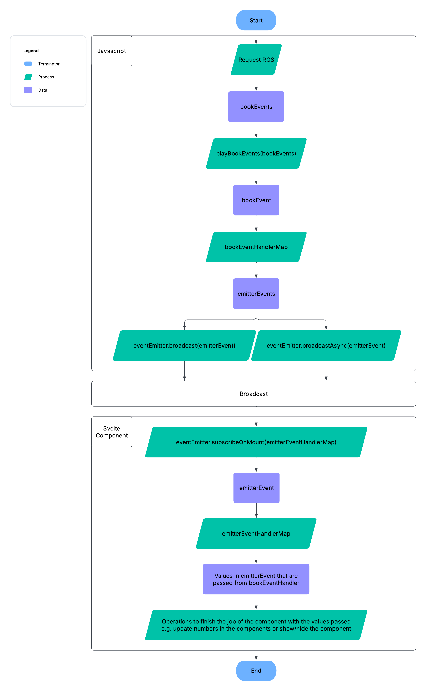
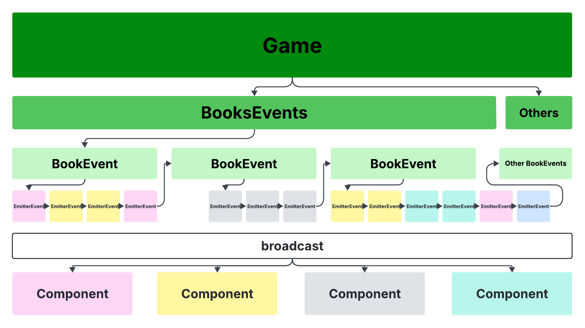
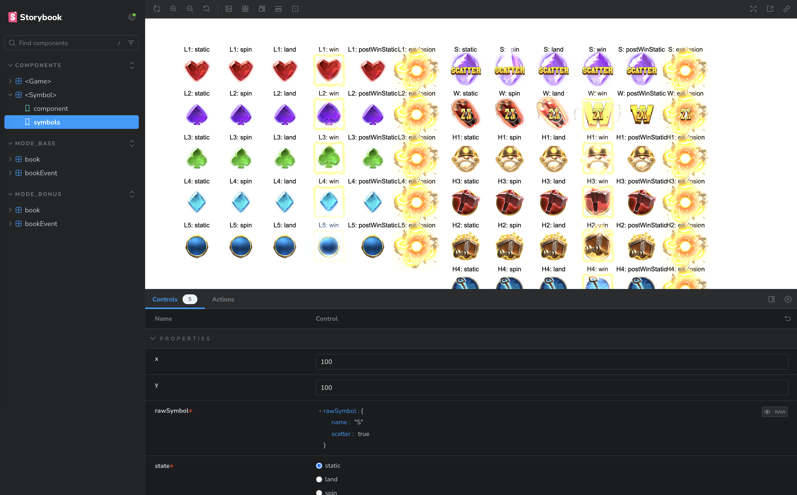
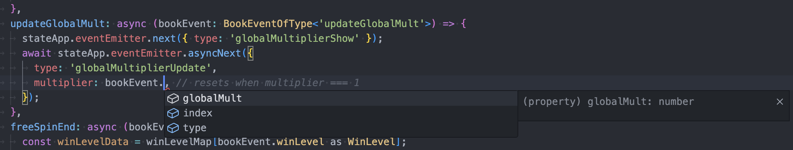
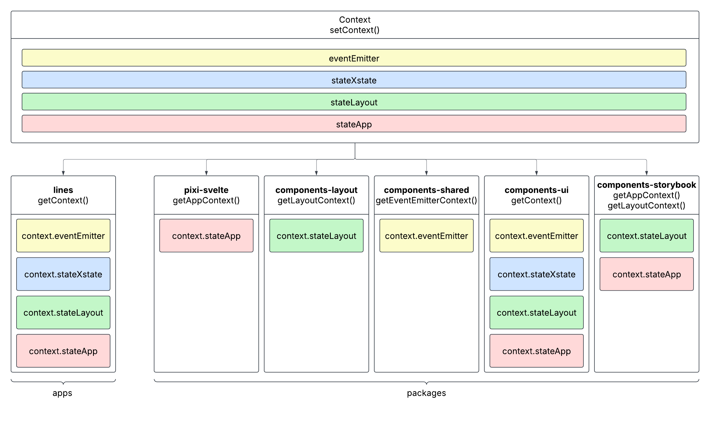
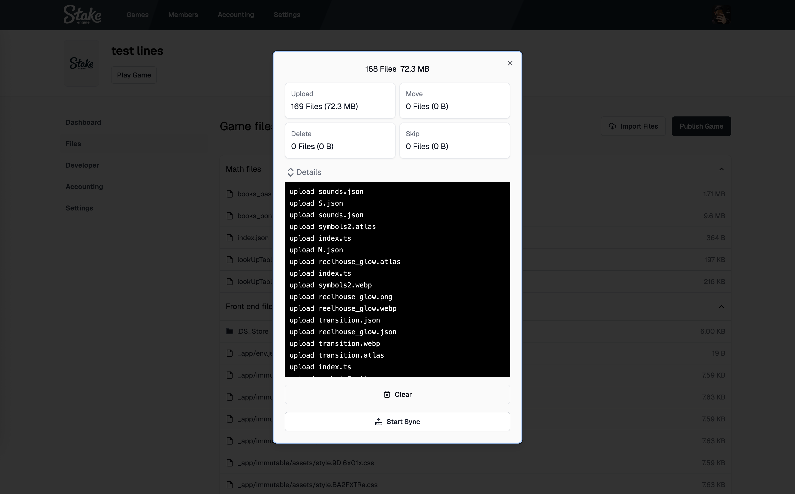
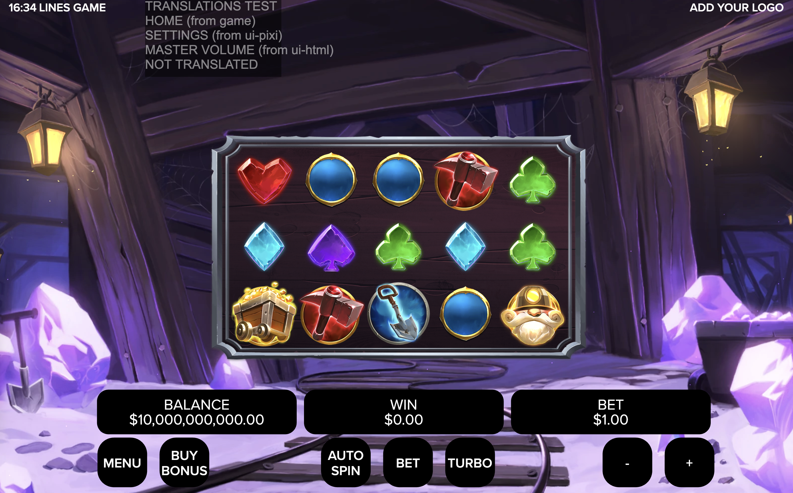

# Web SDK

A toolkit for building slot game frontends in a declarative way for [Stake Engine](https://engine.stake.com/). It uses Svelte 5, PixiJS 8 and TurboRepo.

This repo is trimmed down to **two sample games** so it's easier to learn:

| Game | What it shows |
|---|---|
| [`apps/cluster`](apps/cluster) (main) | Cluster pays, a tumbling (cascading) board, a global multiplier, a multiplier grid, free spins and retriggers. It covers everything the removed `lines`, `ways` and `scatter` samples did. |
| [`apps/price`](apps/price) | Classic spinning reels with sticky symbols, expanding wilds, prize symbols, a win cap, and a third bet mode (`superspin`). |

Everything both games share, such as the UI, the bet logic, the RGS calls and the Pixi helpers, lives in [`packages/`](packages).

# Table of contents

- [Quick start](#quick-start)
- [Commands](#commands)
- [How `pnpm dev` runs without a Stake account](#how-pnpm-dev-runs-without-a-stake-account)
- [Project layout](#project-layout)
- [How a spin flows through the code](#how-a-spin-flows-through-the-code)
- [Storybook](#storybook)
- [Adding a new bookEvent](#adding-a-new-bookevent)
- [Context](#context)
- [UI](#ui)
- [Making your own game](#making-your-own-game)
- [Build and launch on Stake Engine](#build-and-launch-on-stake-engine)
- [FAQ](#faq)
- [Dependencies](#dependencies)

# Quick start

You need:
- **Node 22.18 or newer.** Node 24 works. The local mock server loads `.ts` files with Node's built-in type stripping.
- **pnpm 10.5.0**, installed with `npm install -g pnpm@10.5.0`.

Then run:

```bash
pnpm install
```

```bash
pnpm dev
```

Your browser opens the game by itself, with the launch values in the URL like a real Stake launch. The terminal also prints the link:

```
cluster is running with the local mock RGS.
Open this URL (not the bare "Local:" one above, it has no session):
http://localhost:3001/?sessionID=local&rgs_url=http://localhost:4000&lang=en&currency=USD&device=desktop
```

Don't use Vite's bare `Local: http://localhost:3001/` link. It has no `sessionID` or `rgs_url`, so the game can't log in and shows an error, just as a real game would. Use `pnpm dev --no-open` if you don't want the browser to open automatically.

Click to dismiss the loading screen, then press **BET** or the space bar to spin. You start with $1,000 of play money. Press Ctrl+C to stop everything.

# Commands

All commands run from the repo root.

| Command | What it does | URL |
|---|---|---|
| `pnpm dev` | Plays **cluster** like the real product (mock RGS + dev server) | http://localhost:3001 |
| `pnpm dev:price` | Plays **price** the same way | http://localhost:3002 |
| `pnpm storybook` | Storybook for **cluster**: components, books and single bookEvents with mock data | http://localhost:6001 |
| `pnpm storybook:price` | Storybook for **price** | http://localhost:6002 |
| `pnpm build` | Production build of both games (see [Build and launch](#build-and-launch-on-stake-engine)) | |
| `pnpm preview` | Serves the production build | |
| `pnpm lint` / `pnpm format` | ESLint / Prettier for the whole repo | |
| `pnpm mock-rgs` | Runs only the mock RGS (`--game price`, `--math <dir>`, `--port`, `--balance`) | http://localhost:4000 |

Cluster and price use different ports, so you can run both at the same time.

The shared component packages have their own Storybooks too: `pnpm exec turbo run storybook --filter=<package>`, for example `components-ui-pixi` or `pixi-svelte-storybook`.

# How `pnpm dev` runs without a Stake account

In production, Stake opens the game with a URL like `?sessionID=…&rgs_url=…&lang=en&currency=USD&device=desktop`. The game reads these values in [stateUrl.svelte.ts](packages/state-shared/src/stateUrl.svelte.ts) and talks to Stake's **RGS** (Remote Gaming Server):

| Endpoint | When the game calls it |
|---|---|
| `POST /wallet/authenticate` | On load. Returns the balance, bet levels, jurisdiction rules, and any unfinished round. See [Authenticate.svelte](packages/components-shared/src/components/Authenticate.svelte). |
| `POST /wallet/play` | Every spin. The bet is taken and the RGS returns a **book**, the full result of the round. |
| `POST /bet/event` | As each bookEvent plays, so a reload can resume from the same point |
| `POST /wallet/end-round` | When the round is over. The win is paid out. |

In local development you don't have that server, so the repo includes a fake one in [tools/mock-rgs](tools/mock-rgs). `pnpm dev` and `pnpm dev:price` both run [tools/dev.mjs](tools/dev.mjs), which works like this for each game:

```
pnpm dev            ->  node tools/dev.mjs cluster
pnpm dev:price      ->  node tools/dev.mjs price

tools/dev.mjs <game>
  1. looks up the game's ports         cluster: app 3001, rgs 4000
                                       price:   app 3002, rgs 4001
  2. starts the mock RGS               node tools/mock-rgs/server.mjs --game <game> --port <rgs>
       - loads apps/<game>/src/stories/data/<mode>_books.ts   (one bet mode per file)
       - reads mode costs from apps/<game>/src/game/config.ts
  3. starts the game's dev server      turbo run dev --filter=<game>   (builds pixi-svelte first)
  4. once Vite is ready, prints and opens
       http://localhost:<app>/?sessionID=local&rgs_url=http://localhost:<rgs>&lang=en&currency=USD&device=desktop
  5. Ctrl+C stops both
```

The game code is the same as in production. It only knows about the mock because `rgs_url` in the URL points at it, exactly as a real launch URL points at Stake's RGS.

The mock picks a random book from the same sample data that Storybook uses. It handles balance, bet cost per mode, wins, unfinished rounds and resume, just like the real RGS.

Useful mock links (cluster's mock is on port 4000, price's is on 4001):
- `/mock/status` shows the loaded modes and balances.
- `/mock/force?mode=bonus&id=12` makes the next bonus spin use book 12.
- `/mock/reset` resets the balance.

Only modes that have a books file are accepted: cluster has `base` and `bonus`, and price has `base`, `bonus` and `superspin`. The other buy buttons in the sample UI return "Unknown mode".

When your real math is ready, point the mock at the math SDK output:

```bash
pnpm mock-rgs --game cluster --math path/to/library/publish_files
```

To play against Stake's real staging RGS instead, launch the game from the Stake Engine **Developer** page. Then copy that URL's query string onto `http://localhost:3001/`. See [Build and launch](#build-and-launch-on-stake-engine).

More details are in [tools/mock-rgs/README.md](tools/mock-rgs/README.md).

# Project layout

```
web-sdk/
├── apps/
│   ├── cluster/          ← main sample game
│   └── price/            ← second sample game
├── packages/             ← shared code (UI, bet flow, RGS calls, pixi helpers, configs)
├── tools/
│   ├── dev.mjs           ← `pnpm dev` launcher
│   └── mock-rgs/         ← local fake RGS
└── documentation/        ← images used in this README
```

## Inside a game (`apps/cluster`)

```
apps/cluster/
├── src/
│   ├── routes/        ← entry point (SvelteKit)
│   ├── components/    ← everything on screen
│   ├── game/          ← logic: config, state, bookEvent handlers, event types
│   ├── stories/       ← Storybook stories + data/ (sample books and events)
│   └── i18n/          ← translations
├── static/assets/     ← spines, sprites, audio, fonts
└── .storybook/        ← Storybook config
```

| Path | Purpose |
|---|---|
| [routes/+page.svelte](apps/cluster/src/routes/+page.svelte) | Where the app starts. It calls `setContext()`, then nests the pieces: `<Authenticate>` (talks to the RGS) → `<LoadI18n>` → `<Game />`. It also shows the loader gifs. |
| [components/Game.svelte](apps/cluster/src/components/Game.svelte) | The root of the game. Lists every component: board, tumble board, wins, free spins, UI and so on. **Start reading here.** |
| `components/Board*`, `ReelSymbol`, `Symbol*` | The reels and how each symbol is drawn (spine or sprite) |
| `components/TumbleBoard*`, `TumbleSymbol`, `TumbleWinAmount*` | Cascading: symbols explode, the rest slide down, and new ones drop in |
| `components/ClusterWinAmount*`, `MultiplierGrid`, `GlobalMultiplier` | Cluster-specific win display and multipliers |
| `components/FreeSpin*`, `Win*`, `Transition*`, `LoadingScreen` | Free spins intro, counter and outro; big wins; scene transitions; the loading screen |
| `components/EnableGameActor`, `EnableSound`, `ResumeBet` | Wiring with no visuals: starts the state machine and sound, and resumes an unfinished round |
| [game/config.ts](apps/cluster/src/game/config.ts) | The game config from the math side: reels, rows, bet modes and their costs, paytable |
| [game/bookEventHandlerMap.ts](apps/cluster/src/game/bookEventHandlerMap.ts) | **The core of the game.** For each bookEvent type, it says what to animate. |
| `game/typesBookEvent.ts`, `game/typesEmitterEvent.ts` | TypeScript types for bookEvents and emitterEvents |
| `game/eventEmitter.ts` | The event bus that connects the logic to the components |
| `game/stateGame.svelte.ts` | Game state: base or free game, board contents and so on |
| `game/actor.ts`, `game/stateXstate.ts` | Spin-flow state machine: idle → bet → play book → end round |
| `game/stateLayout.ts`, `game/stateApp.ts` | Screen layout and the Pixi app state |
| [game/context.ts](apps/cluster/src/game/context.ts) | Creates all of the above as Svelte context |
| `game/assets.ts`, `game/sound.ts` | Which files in `static/assets` to load, and the sound names |
| `game/winLevelMap.ts` | Win tiers (small, big, mega…) with their animations and sounds |
| `stories/data/*_books.ts` | Sample books per bet mode. Used by Storybook **and** by the mock RGS. |
| `stories/data/*_events.ts` | One example of each bookEvent type, used by the `MODE_*/bookEvent/*` stories |

`apps/price` has the same layout. It adds `StickyBoard*`, `ExpandingWild*` and `SymbolPrize`, plus `superspin` books and stories.

## Packages

You can import a package into an app or into another package with `"<name>": "workspace:*"`, without publishing it. Package names follow the pattern `<type>-<what it depends on or is for>`.

| Package | Purpose |
|---|---|
| **config-\*** | Shared configs: [config-vite](packages/config-vite), [config-svelte](packages/config-svelte), [config-ts](packages/config-ts), [config-storybook](packages/config-storybook), [config-lingui](packages/config-lingui), [eslint-config-custom](packages/eslint-config-custom) |
| [pixi-svelte](packages/pixi-svelte) | PixiJS as declarative Svelte components (`<App>`, `<Sprite>`, `<SpineProvider>` …). Creates `stateApp` and `ContextApp`. **It is used from its built `dist/`.** `pnpm dev` and `pnpm storybook` rebuild it automatically. |
| [pixi-svelte-storybook](packages/pixi-svelte-storybook) | Storybook for pixi-svelte components |
| [constants-shared](packages/constants-shared) | Global constants, for example `API_AMOUNT_MULTIPLIER` (1,000,000 = $1) |
| [state-shared](packages/state-shared) | Global state: bet, balance, URL params, modals, bet-mode metadata |
| [rgs-requests](packages/rgs-requests), [rgs-fetcher](packages/rgs-fetcher) | Typed RGS API calls: authenticate, play, end-round, event, replay |
| [utils-xstate](packages/utils-xstate) | The bet state machine (bet, autoBet, resumeBet), including when to call end-round |
| [utils-book](packages/utils-book) | `playBookEvents()`, `recordBookEvent()` and other book helpers |
| [utils-event-emitter](packages/utils-event-emitter) | The emitter used for event-driven programming. Creates `ContextEventEmitter`. |
| [utils-layout](packages/utils-layout) | Canvas sizes and layout types (desktop, portrait…). Creates `ContextLayout`. |
| [utils-slots](packages/utils-slots) | Reel creation and spinning |
| [utils-sound](packages/utils-sound) | Music and sound effects (howler) |
| `utils-shared`, `utils-bet`, `utils-fetcher`, `utils-resize-observer`, `envs` | Smaller helpers |
| [components-ui-pixi](packages/components-ui-pixi) | The in-canvas game UI: bet button, autoplay, turbo, buy bonus, balance… |
| [components-ui-html](packages/components-ui-html) | HTML UI: modals, menus, the error popup |
| [components-shared](packages/components-shared) | Authenticate, loaders, i18n loading, hotkeys |
| [components-layout](packages/components-layout), [components-pixi](packages/components-pixi) | Reusable layout and Pixi components |
| [components-storybook](packages/components-storybook) | Helpers for writing stories |

If you change something in `packages/`, it changes for **both** games.

# How a spin flows through the code



1. The player presses **BET**. The state machine ([utils-xstate](packages/utils-xstate/src/createPrimaryMachines.ts)) calls `/wallet/play` and receives a **book**.
2. `playBookEvents()` goes through `book.events` one by one, **in order**.
3. Each **bookEvent** is passed to its handler in `bookEventHandlerMap`, chosen by `bookEvent.type`.
4. The handler **broadcasts emitterEvents**. Components subscribe to them and animate.
5. When the book is finished, the state machine calls `/wallet/end-round` and the balance updates.

## book and bookEvent

A **book** is the full result of one round. The RGS picks it from the math's (very large) list of possible results. It's mostly an array of **bookEvents**:

```ts
// apps/cluster/src/stories/data/base_books.ts (shortened)
{
  id: 1,
  payoutMultiplier: 0.0,
  events: [
    { index: 0, type: 'reveal', board: [[{ name: 'L1' }, { name: 'H1' }, …], …], gameType: 'basegame', … },
    { index: 1, type: 'setTotalWin', amount: 0 },
    { index: 2, type: 'finalWin', amount: 0 },
  ],
}
```

Different combinations of bookEvents produce different rounds: a win or a loss, a small or big win, a base game or a bonus, 1 tumble or 10, and so on. **The order of the events matters:** the game plays them exactly in that order.

## bookEventHandlerMap

This is an object keyed by `bookEvent.type`. Each handler takes the bookEvent and broadcasts emitterEvents:

```ts
// apps/cluster/src/game/bookEventHandlerMap.ts
updateGlobalMult: async (bookEvent: BookEventOfType<'updateGlobalMult'>) => {
  eventEmitter.broadcast({ type: 'globalMultiplierShow' });
  await eventEmitter.broadcastAsync({
    type: 'globalMultiplierUpdate',
    multiplier: bookEvent.globalMult,
  });
},
```

## eventEmitter and emitterEvents

The emitter connects plain TypeScript logic to Svelte components without passing props around:

- `eventEmitter.broadcast(event)` fires the event and carries on (show, hide, set a number).
- `await eventEmitter.broadcastAsync(event)` fires the event and **waits** until the component finishes, for example an animation or a count-up.
- `context.eventEmitter.subscribeOnMount({ type: handler, … })` is how a component listens.

```svelte
<!-- apps/cluster/src/components/FreeSpinCounter.svelte -->
<script lang="ts" module>
  export type EmitterEventFreeSpinCounter =
    | { type: 'freeSpinCounterShow' }
    | { type: 'freeSpinCounterHide' }
    | { type: 'freeSpinCounterUpdate'; current?: number; total?: number };
</script>

<script lang="ts">
  context.eventEmitter.subscribeOnMount({
    freeSpinCounterShow: () => (show = true),
    freeSpinCounterHide: () => (show = false),
    freeSpinCounterUpdate: (e) => {
      if (e.current !== undefined) current = e.current;
      if (e.total !== undefined) total = e.total;
    },
  });
</script>
```

Keep each emitterEvent handler small, with one job. For example, `freeSpinCounterShow` only shows the counter.

## Task breakdown

Split a complicated bookEvent into small emitterEvents so you can build and test each step on its own. Cluster's `tumbleBoard` is the clearest example:

```ts
// apps/cluster/src/game/bookEventHandlerMap.ts
tumbleBoard: async (bookEvent) => {
  eventEmitter.broadcast({ type: 'boardHide' });
  eventEmitter.broadcast({ type: 'tumbleBoardShow' });
  eventEmitter.broadcast({ type: 'tumbleBoardInit', addingBoard: bookEvent.newSymbols });
  await eventEmitter.broadcastAsync({ type: 'tumbleBoardExplode', explodingPositions: bookEvent.explodingSymbols });
  eventEmitter.broadcast({ type: 'tumbleBoardRemoveExploded' });
  await eventEmitter.broadcastAsync({ type: 'tumbleBoardSlideDown' });
  eventEmitter.broadcast({ type: 'boardSettle', board: … });
  …
},
```



The emitterEvents for one bookEvent can come from different components. That's how timing between components is controlled.

# Storybook

Use `pnpm storybook` to test a game without any backend:

- `COMPONENTS/<Game>/*` shows the whole game: the loading screen, preSpin, and single emitterEvents.
- `COMPONENTS/<Symbol>/*` shows each symbol in each state, with controls.
- `MODE_BASE/book/random` and `MODE_BONUS/book/random` play a random sample book. Press **Action**.
- `MODE_BASE/bookEvent/<type>` and `MODE_BONUS/bookEvent/<type>` play **one** bookEvent.



If every bookEvent works in its own story and the book stories play correctly, the game logic is done. Then run `pnpm dev` to check it as the real product, with the bet flow, balance and resume.

On Windows, the first Storybook load can be slow. [config-storybook](packages/config-storybook/src/main.ts) turns off the Svelte docgen plugin for this reason, so the Docs tab has no prop tables.

# Adding a new bookEvent

Say your math adds an `updateGlobalMult` event to bonus mode. Cluster already has it, so you can use it as the reference.

1. **Sample data.** Add the event to a book in `apps/cluster/src/stories/data/bonus_books.ts`, and one example to `bonus_events.ts`:
   ```ts
   updateGlobalMult: { type: 'updateGlobalMult', globalMult: 3 },
   ```
2. **Story.** Add a story to [ModeBonusBookEvent.stories.svelte](apps/cluster/src/stories/ModeBonusBookEvent.stories.svelte):
   ```svelte
   <Story name="updateGlobalMult" args={templateArgs({
     skipLoadingScreen: true,
     data: events.updateGlobalMult,
     action: async (data) => await playBookEvent(data, { bookEvents: [] }),
   })} />
   ```
3. **Type.** Add it to the `BookEvent` union in [typesBookEvent.ts](apps/cluster/src/game/typesBookEvent.ts):
   ```ts
   type BookEventUpdateGlobalMult = { index: number; type: 'updateGlobalMult'; globalMult: number };
   ```
4. **Component and emitterEvents.** Create or extend a component such as [GlobalMultiplier.svelte](apps/cluster/src/components/GlobalMultiplier.svelte) with its own `EmitterEvent…` type. Add that type to [typesEmitterEvent.ts](apps/cluster/src/game/typesEmitterEvent.ts), and subscribe to the events in the component.
5. **Handler.** Add `updateGlobalMult` to [bookEventHandlerMap.ts](apps/cluster/src/game/bookEventHandlerMap.ts). TypeScript now autocompletes the event's fields:

   
6. **Test it on its own** in `MODE_BONUS/bookEvent/updateGlobalMult` (press Action, and it should resolve ✅). Then **test it inside books** with `MODE_BONUS/book/random`. Finally, run **`pnpm dev`** and use `localhost:4000/mock/force?mode=bonus&id=<book id>` to play that book through the real bet flow.

# Context

`setContext()` runs once at the entry point ([+page.svelte](apps/cluster/src/routes/+page.svelte), or a story). Any child component can then call `getContext()`:

```ts
// apps/cluster/src/game/context.ts
export const setContext = () => {
  setContextEventEmitter<EmitterEvent>({ eventEmitter });
  setContextXstate({ stateXstate, stateXstateDerived });
  setContextLayout({ stateLayout, stateLayoutDerived });
  setContextApp({ stateApp });
};
```



| Context | Created by | Gives you |
|---|---|---|
| ContextEventEmitter | [utils-event-emitter](packages/utils-event-emitter/src/createEventEmitter.ts) | `eventEmitter` |
| ContextLayout | [utils-layout](packages/utils-layout/src/createLayout.svelte.ts) | `canvasSizes()`, `layoutType()` (desktop, portrait…) and so on. Pixi has no auto-layout, so you position things against these values. |
| ContextXstate | [utils-xstate](packages/utils-xstate/src/createXstateUtils.svelte.ts) | `isIdle()`, `isBetting()`, `isPlaying()`… For example, the bet button is disabled while `isPlaying()` is true. |
| ContextApp | [pixi-svelte](packages/pixi-svelte/src/lib/createApp.svelte.ts) | `stateApp.loadedAssets` (textures, spines, sounds) and the Pixi application |

The bet flow is an xstate machine (`rendering → idle → bet / autoBet / resumeBet`), which avoids long chains of if/else checks.

# UI

[components-ui-pixi](packages/components-ui-pixi) and [components-ui-html](packages/components-ui-html) provide a working UI: bet, autoplay, turbo, buy bonus, menus and modals. Each game puts its name and logo into it:

```svelte
<UI>
  {#snippet gameName()}<UiGameName name="CLUSTER GAME" />{/snippet}
  {#snippet logo()}<Text text="ADD YOUR LOGO" … />{/snippet}
</UI>
```

Treat it as a starting point and restyle it for your own brand.

# Making your own game

1. Copy `apps/cluster` (or `apps/price` if you want spinning reels with sticky or expanding features) to `apps/my-game`. Leave out `node_modules`, `.svelte-kit` and `.turbo`.
2. In its `package.json`, set `"name": "my-game"` and choose free ports for `dev` and `storybook`.
3. Add it to the `GAMES` map in [tools/dev.mjs](tools/dev.mjs), with its app port and RGS port. Then add `"dev:my-game": "node tools/dev.mjs my-game"` to the root `package.json`.
4. Run `pnpm install`.
5. Replace the following with your own:
   - `game/config.ts`, using your math SDK config
   - the books in `stories/data/`
   - the assets in `static/assets` and `game/assets.ts`
   - the symbols, and any new bookEvents (see [Adding a new bookEvent](#adding-a-new-bookevent))

# Build and launch on Stake Engine

```bash
pnpm build
```

For each game, put `apps/<game>/.svelte-kit/output/prerendered/pages/index.html` and everything in `apps/<game>/.svelte-kit/output/client` into one folder:

```
build/
  index.html
  _app/
  assets/
  favicon.svg
  loader.gif
  stake-engine-loader.gif
```

Then:
1. Log in to [Stake Engine](https://engine.stake.com/), open your game, go to **Files**, and import the whole build folder.

   
2. Click **Publish Game** → **Front End**.
3. Go to **Developer** → **Start game session** → **Launch in New Tab**. The game is now running on staging.

   
4. Optional: copy that tab's query string (`?sessionID=…&rgs_url=…`) onto `http://localhost:3001/`. Your local dev build then plays against the real staging RGS instead of the mock.

# FAQ

- **Can I use something other than Svelte, or Pixi only?** Yes. Anything that compiles to a static website works. This SDK is just the fastest way, because the integration is already done.
- **How does my own frontend get config, jurisdiction and currency?** From `/wallet/authenticate`. See [Authenticate.svelte](packages/components-shared/src/components/Authenticate.svelte). Currencies are formatted by `numberToCurrencyString` in `packages/utils-shared`.
- **When should end-round be called?** It depends on the type of bet. Calling it decides whether a round can be resumed. See `BET_TYPE_METHODS_MAP` in [createPrimaryMachines.ts](packages/utils-xstate/src/createPrimaryMachines.ts):
  - a losing round never calls it
  - a single-round win calls it right after play, and the balance updates at the end
  - a bonus calls it after the last event
- **Are there alternatives to Spine?** Sprite sheet animation. See [SpriteSheet.stories.svelte](packages/pixi-svelte-storybook/src/stories/SpriteSheet.stories.svelte).
- **Can a game switch mechanics mid-round, for example from reels to cluster?**
  1. Add a bookEvent in your math that tells the game to switch.
  2. Handle it in `bookEventHandlerMap` by broadcasting emitterEvents.
  3. Subscribe to them in `Board.svelte` and do the switch there.

  That bookEvent → emitterEvent → component pattern covers almost anything.
- **What do social casinos (stake.us) need?** Different UI wording when the URL has `social=true`, for example "BET" becomes "SPIN". See `packages/components-ui-pixi/src/i18n/i18nDerived.ts`.
- **My change in `packages/pixi-svelte` doesn't show up.** That package is used from its built `dist/`. Restart `pnpm dev` or `pnpm storybook` (both rebuild it), or run `pnpm exec turbo run build --filter=pixi-svelte`.
- **The first `pnpm dev` load shows errors like `key "…" is not found in loadedAssets`.** Vite was re-bundling dependencies during the first load. [config-vite](packages/config-vite/index.js) now pre-bundles them. If it still happens, refresh once.
- **"Unknown mode" error when buying a feature locally.** The mock only has books for some modes (cluster: `base`, `bonus`). Add a `<mode>_books.ts` file, or use `--math`.

# Dependencies

- [PixiJS](https://pixijs.download/release/docs/index.html) for 2D WebGL/WebGPU rendering
- [Svelte 5](https://svelte.dev/docs/svelte/overview) and [SvelteKit](https://svelte.dev/docs/kit/introduction)
- [pixi-svelte](https://www.npmjs.com/package/pixi-svelte), which lets you use Pixi as Svelte components (in-house, see `packages/pixi-svelte`)
- [XState](https://stately.ai/docs/) for the bet-flow state machine
- [Storybook](https://storybook.js.org/tutorials/intro-to-storybook/svelte/en/get-started/)
- [TurboRepo](https://turbo.build/repo/docs) and [pnpm](https://pnpm.io/) for the monorepo
- [TypeScript](https://www.typescriptlang.org/docs/)
- Math: [Stake math SDK](https://stakeengine.github.io/math-sdk/math_docs/general_overview/), which produces the books
